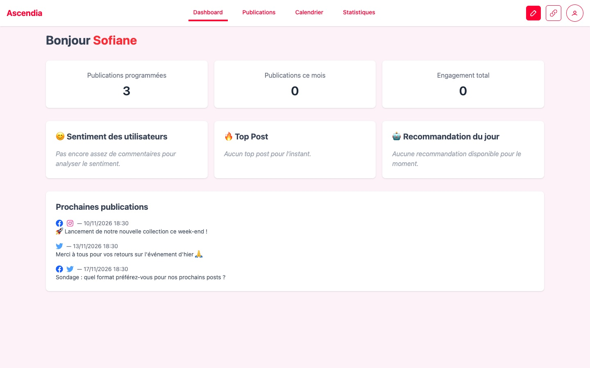
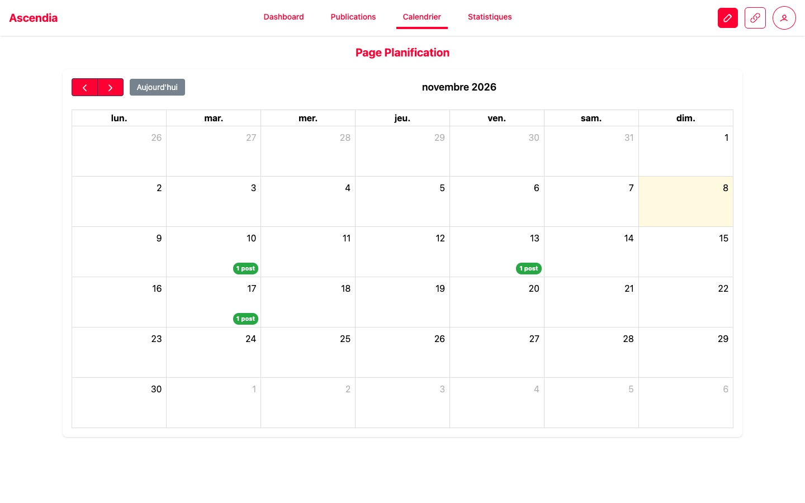
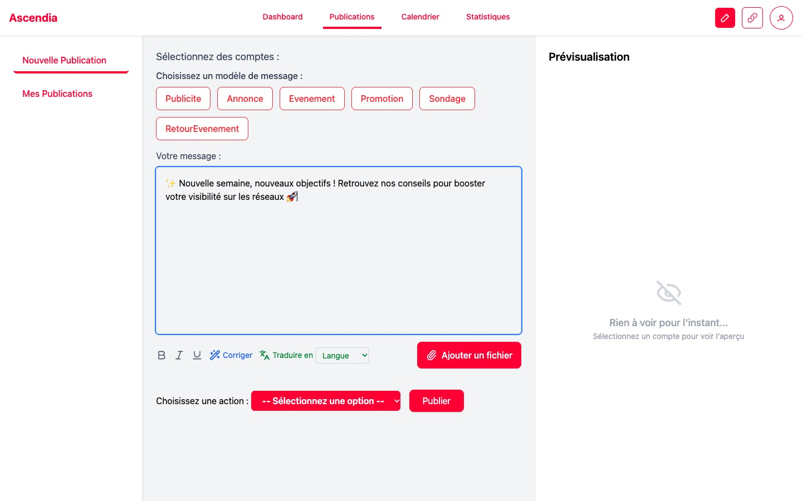
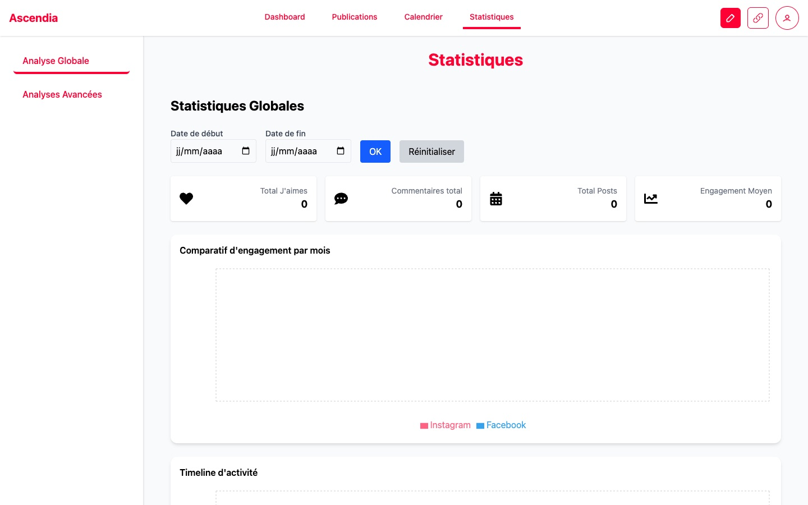

#  Ascendia

> **Gérez, planifiez et analysez vos réseaux sociaux au même endroit, avec l'aide de l'IA.**


Ascendia centralise les comptes **Facebook, Instagram et X (Twitter)** d'un utilisateur : rédaction et publication
multi-réseaux, planification dans un calendrier, statistiques d'engagement et assistance IA (correction,
traduction, analyse du sentiment des commentaires, recommandation du jour).


## Aperçu

| Tableau de bord | Calendrier de planification |
| --- | --- |
|  |  |
| **Nouvelle publication** (modèles, correction et traduction IA) | **Statistiques** |
|  |  |

## Fonctionnalités

- **Connexion des réseaux** Facebook (pages), Instagram et X via OAuth
- **Publication** immédiate sur plusieurs réseaux à la fois, avec image, et un résultat par réseau
- **Planification** : les posts sont publiés automatiquement à l'heure choisie (tâche planifiée côté serveur), et affichés dans un calendrier
- **Statistiques** : j'aime, commentaires, engagement par mois, meilleure publication, détail par publication
- **IA** (OpenRouter) :
  - correction et traduction des messages avant publication ;
  - score de satisfaction calculé à partir des commentaires reçus ;
  - recommandation quotidienne personnalisée à partir de l'historique de publications

## Architecture

```
                         ┌──────────────┐
  Navigateur (React) ──► │   Gateway    │  point d'entrée unique /api
                         └──────┬───────┘
          ┌─────────────────────┼──────────────────────┐
          ▼                     ▼                      ▼
   ┌─────────────┐      ┌───────────────┐      ┌───────────────┐
   │    users    │      │  socialAuth   │◄─────│     posts     │
   │ comptes,JWT │      │ OAuth, tokens │ clé  │ publication,  │
   └──────┬──────┘      └───────┬───────┘interne│ stats, IA,    │
          │                     │              │ tâches cron   │
          └──────────── MongoDB ┴──────────────┴───────────────┘
```

| Service | Rôle |
| --- | --- |
| `gateway` | Proxy vers les microservices ; bloque les routes internes |
| `users` | Inscription, connexion (bcrypt + JWT), profil |
| `socialAuth` | Connexion OAuth aux réseaux, stockage des tokens |
| `posts` | Publication multi-réseaux, planification (cron), statistiques, fonctions IA |
| `frontend` | Application React (Vite, Tailwind CSS, Recharts, FullCalendar) |

Les tokens des réseaux sociaux **ne quittent jamais le backend** : le service `posts` les obtient auprès de
`socialAuth` par un appel de service à service protégé par une clé interne.

## Lancer le projet

### Avec Docker (recommandé)

```bash
git clone https://github.com/sofianeham34/Application-de-gestion-et-d-analyse-des-r-seaux-sociaux-.git ascendia
cd ascendia/backend
cp .env.example .env        # renseigner au minimum JWT_SECRET et INTERNAL_API_KEY
docker compose up --build
```

L'application est disponible sur **http://localhost:8080**.

### Sans Docker

Prérequis : Node.js 20+ et MongoDB en local.

```bash
npm run install:all                     # installe chaque service
cp backend/.env.example backend/.env    # même fichier pour tous les services
npm run dev                             # 4 services + frontend sur http://localhost:5173
```

### Clés API

| Variable | Où l'obtenir |
| --- | --- |
| `CLE_API_IA` | [OpenRouter](https://openrouter.ai/keys) |
| `FACEBOOK_CLIENT_ID/SECRET`, `INSTAGRAM_CLIENT_ID/SECRET` | [Meta for Developers](https://developers.facebook.com/) |
| `TWITTER_KEY/SECRET` | [X Developer Portal](https://developer.x.com/) |

Sans clé, l'application fonctionne quand même : un réseau non configuré est simplement désactivé
(comptes, planification, calendrier et interface restent utilisables).

## Tests

```bash
npm install && npm test
```

13 tests d'intégration (`node:test`, base MongoDB en mémoire) lancent les microservices et vérifient le
contrôle d'accès :
- connexion par email ou pseudo, sans révéler quels comptes existent ;
- impossible de se donner le rôle admin ou de modifier le profil d'un autre ;
- connexions et tokens d'un utilisateur inaccessibles aux autres, route interne non exposée par la gateway ;
- publications planifiées visibles et supprimables uniquement par leur auteur ;
- validation des dates et des fichiers envoyés.

## Sécurité

- Mots de passe hachés avec **bcrypt**, sessions par **JWT**
- Chaque route vérifie l'utilisateur connecté et la propriété des ressources
- Champs modifiables du profil limités (pas de modification du rôle)
- Tokens OAuth stockés côté serveur uniquement, jamais renvoyés au navigateur
- En-têtes HTTP sécurisés (Helmet), uploads limités aux images de 8 Mo maximum avec un nom de fichier aléatoire

## Équipe

Projet de **Licence 3 Informatique** à l'Université de Montpellier, réalisé par **Sami Chbicheb**,
**Samir El Khoumri**, **Aly Hachem Reda** et **Sofiane Hammar**.
